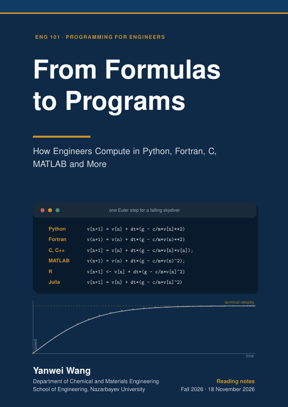
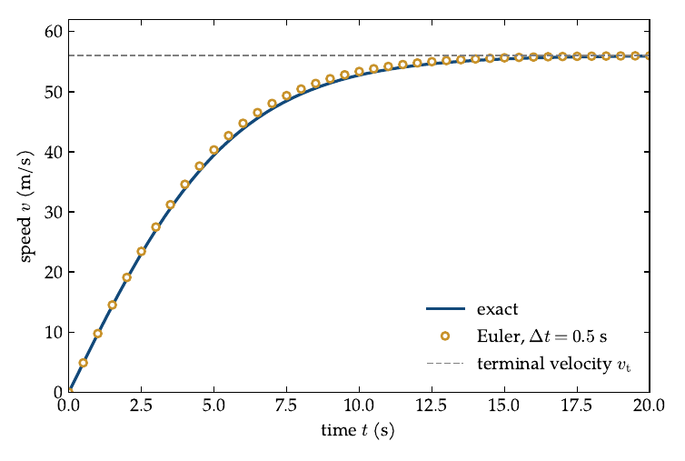
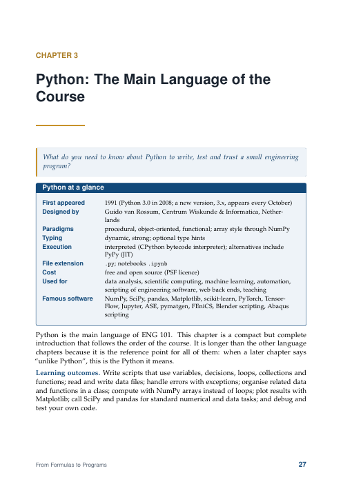
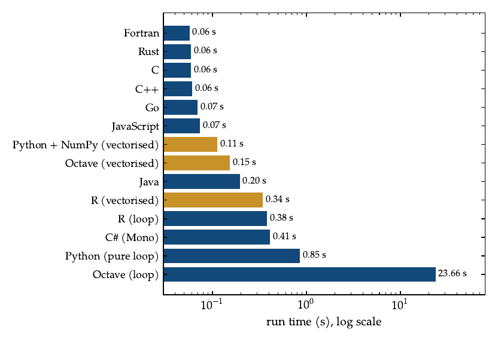

<div align="center">

# From Formulas to Programs

**How engineers compute in Python, Fortran, C, MATLAB and more — a book for first-year engineering
students, with every example program provided as a file and checked against its printed output.**

[](From_Formulas_to_Programs.pdf)
[](code)
[](LICENSE)
[](DATA_LICENSE.md)



</div>

You learn to program in one language and then meet many others: a solver written in Fortran, a
MATLAB script from a colleague, a controller programmed in Structured Text, a dashboard in
JavaScript. This book is a map of that landscape for engineering students. It is the reading
material for **ENG 101 Programming for Engineers** at Nazarbayev University, where the main language
is Python. Each chapter introduces one language: where it came from, what engineers use it for, how
to write and run a first program, and what it is good and bad at. The same small problem, a falling
skydiver with air drag solved by the Euler method, is programmed in every language, so the
languages can be compared line by line.

> **Start in 60 seconds:** open [`From_Formulas_to_Programs.pdf`](From_Formulas_to_Programs.pdf) and
> read "How to Use These Notes", or open the executed notebook
> [`notebooks/running_example.ipynb`](notebooks/running_example.ipynb) here on GitHub.

## Why this book?

- **One problem, many languages.** The falling-skydiver calculation appears in Python, Fortran, C,
  C++, C#, Java, JavaScript, MATLAB, the Wolfram Language, R, Julia, Rust and Go.
- **Every printed program is a file.** Complete programs are in [`code/`](code), one folder per
  language. The output printed in the book under each program is the stored output of a real run.
- **Written for beginners.** No knowledge beyond the first weeks of a Python course is assumed.
  Each chapter opens with a question and its learning outcomes, and ends with exercises.
- **Honest about what was tested.** See [Scope and limitations](#scope-and-limitations).

## What the checks show

The script [`tools/check_examples.py`](tools/check_examples.py) builds and runs each example and
compares what it prints with the stored `.out` file.

| Check | Result |
|---|---|
| Euler table for the skydiver in Python, Fortran, C, C++, C#, Java, JavaScript, Octave, R, Rust, Go | the same numbers to all printed digits |
| Speed after 10 s with SciPy's adaptive solver | 52.749607 m/s; exact 52.749607 m/s |
| Newton's method for x³ − 2x − 5 = 0 in all 13 languages of Chapter 15 | 2.094551481542327 after 5 iterations (C# under Mono prints the last digits as 330) |
| Trapezoidal rule for ∫ sin x dx from 0 to π, n = 100 | 1.999835503887444; R and the Wolfram Language print …443, the exactly rounded sum (Chapter 15 explains why) |
| All examples re-run on 18 November 2026 | 51 identical to the stored output, 2 run but vary by design (timings, memory addresses); the 5 Julia and Wolfram Language programs were run by the author in Julia 1.13 and Mathematica and agree with the others |

<p align="center">

</p>

<sub>The running example. The exact solution, the Euler method with a time step of 0.5 s, and the
terminal velocity of 56.03 m/s. All parameter values are assumed teaching values.</sub>

## Gallery

<p align="center">


</p>

<sub>Left: a chapter opener. Right: the run time of one numerical loop in each language, measured on
one computer (Chapter 15); the numbers are illustrative and will differ on other machines.</sub>

## Installation

Nothing needs to be installed to read the book. To run the programs:

```bash
git clone https://github.com/ktwyw/from-formulas-to-programs.git
cd from-formulas-to-programs
pip install -r requirements.txt     # for the Python examples and the notebook
```

The guide "Installing and Running the Languages" at the back of the book lists a free compiler or
interpreter for each of the other languages.

## Quick start

```bash
cd code/python
python3 drag.py                      # prints the table shown in every language chapter

cd ../..
python3 tools/check_examples.py      # re-runs every example; missing languages are skipped
```

## What's inside

| Chapter | Topic |
|---|---|
| 1–2 | What a programming language is; how code runs; how numbers are stored |
| 3 | Python, the main language of the course, including NumPy, Matplotlib, SciPy and pandas |
| 4–8 | Fortran, C, C++, C# and Java |
| 9 | JavaScript and TypeScript |
| 10–13 | MATLAB and GNU Octave, the Wolfram Language, R and Julia |
| 14 | Rust, Go, SQL, Bash, Excel and VBA, PLC languages, VHDL and Verilog, Modelica, G-code and others |
| 15 | A Rosetta Stone: three numerical tasks in thirteen languages, and a speed comparison |
| 16 | Choosing a language; version control, testing, documentation, AI assistants, licences |
| Epilogue | The past and future of the languages of engineering |
| Back matter | Installation guide, Python quick reference, numerical functions across languages, glossary, answers to selected exercises, index |

## The `code` folder

| Folder | Contents |
|---|---|
| `python/` | 10 programs: the running example, Newton's method, a class for pipes, file reading, NumPy, SciPy and pandas examples, a small molecular dynamics simulation, and the plotting script |
| `fortran/`, `c/`, `cpp/`, `csharp/`, `java/`, `javascript/`, `matlab/`, `r/` | the running example and the other programs of each language chapter |
| `julia/`, `wolfram/` | the programs of Chapters 13 and 11 (all run) |
| `rust/`, `go/`, `sql/`, `bash/` | the tested examples of Chapter 14 |
| `others/` | untested fragments: VBA, Structured Text, Verilog, VHDL, Modelica, G-code, Arduino, TypeScript |
| `rosetta/` | the three tasks of Chapter 15 in thirteen languages |
| `bench/` | the timing programs behind the speed comparison, with the measured times |
| `data/` | two small data files with invented teaching values |

Each `name.out` file is the output of the program beside it.

## Repository layout

```
From_Formulas_to_Programs.pdf   the book
main.tex, metadata.tex,         LaTeX source of the book
booksetup.tex, codebook.tex,      (compile with: latexmk -pdf main.tex,
frontmatter/, chapters/,           or open in Overleaf with main.tex and pdfLaTeX)
backmatter/, figures/
code/                           all example programs, their outputs and data
notebooks/                      an executed companion notebook for the running example
tools/check_examples.py         re-runs the examples and compares the outputs
docs/images/                    images used in this README
ERRATA.md, CHANGELOG.md         corrections since the first version
```

The book prints the programs directly from the files in `code/`, so the PDF and the files cannot
drift apart.

## Suggested references

Each language chapter ends with a short "Further reading" list of free tutorials and standard
textbooks for that language.

## Companion books

- [onsager-variational-methods](https://github.com/ktwyw/onsager-variational-methods): variational
  methods in soft matter.
- [math-perturbation-methods](https://github.com/ktwyw/math-perturbation-methods): perturbation methods
  for differential equations.
- [math-asymptotic-methods](https://github.com/ktwyw/math-asymptotic-methods): asymptotic expansions of
  integrals and sums.
- [error-analysis](https://github.com/ktwyw/error-analysis): evaluating, propagating and reporting
  uncertainty.

## Scope and limitations

- The book is an overview. It does not replace a course or a textbook in any of the languages.
- Every complete program in the book has been run. The Wolfram Language programs were run by the
  author in Mathematica and the Julia programs in Julia 1.13; their outputs are stored beside them
  as `.out` files. Only the short fragments in `code/others/` (VBA, Structured Text, Verilog, VHDL,
  Modelica, G-code, Arduino, TypeScript), which need special tools, were checked by hand and have
  not been run. Please report any error.
- MATLAB examples were run in GNU Octave 8.4 and C# examples with Mono 6.8. Their output in MATLAB or
  in current .NET may differ in formatting.
- The speed comparison of Chapter 15 was measured once on one two-core server. In particular, loops
  run much faster in MATLAB than in Octave.
- The popularity table of Chapter 1 is a snapshot of the TIOBE index for November 2026.
- Parameter values and data files are assumed or invented for teaching; no experimental data are
  included.
- Version numbers, product names and book editions were correct to the author's knowledge in
  November 2026 and will age.
- The part of the Epilogue that looks ahead is opinion.
- The book was prepared with AI assistance in drafting, programming and typesetting. The author
  reviewed it and is responsible for its content.

## Roadmap

- Corrections from the Fall 2026 class.

## Author

**Yanwei Wang**, Department of Chemical and Materials Engineering, School of Engineering, Nazarbayev
University, Astana, Kazakhstan · yanwei.wang@nu.edu.kz ·
ORCID [0000-0002-8488-9833](https://orcid.org/0000-0002-8488-9833)

## Citing

Please cite the material using the metadata in [`CITATION.cff`](CITATION.cff).

## License

Code (`code/`, `tools/`, the scripts in `figures/` and the code cells of the notebook):
[MIT](LICENSE). Text, figures and notebook outputs, including the book and its LaTeX source:
[CC BY 4.0](DATA_LICENSE.md).
